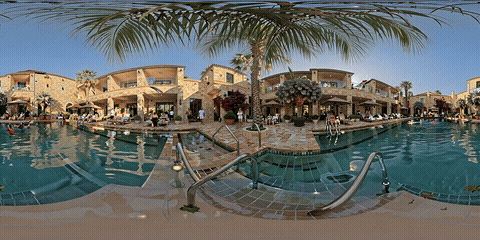
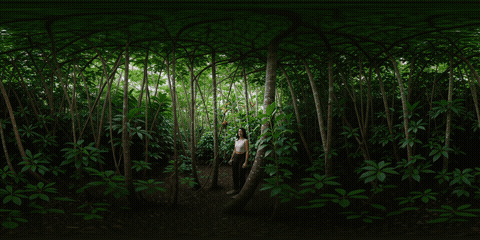
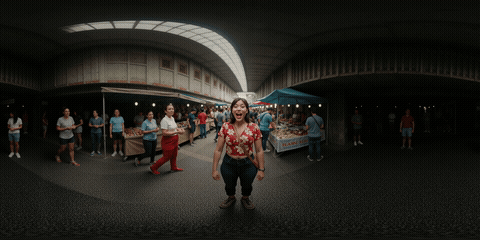
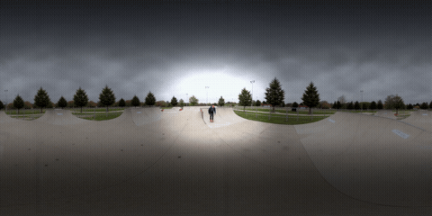

# ComfyUI-Seamless-Equirectangular

**ComfyUI-Seamless-Equirectangular** is a ComfyUI custom node pack by **Burgstall Labs** for seamless equirectangular, 360-degree, VR, and panoramic image or video generation with Krea2, LTX-2.3, LTX-2.5, and MiniMax H3. It provides training-free seam mitigation and geometry enhancement for equirectangular inference.

The pack combines circular VAE padding, native dual-rotation decoding, latent rolling, wrapped noise and positional encoding methods inspired by [SpheRoPE](https://arxiv.org/abs/2606.32033). **EquiRoPE** is a distinct latitude-scaled RoPE with pole gating and hemisphere selection. Which methods help depends on the model and conditioning: the tested LTX 2.5 starting points below use existing equirectangular inputs, native dual-rotation decoding and no panorama LoRA or geometry patches. These methods reduce seam artifacts; they do not guarantee coherent poles, stable textures or artifact-free moving-camera video.

The LoRA is available on Hugging Face: [TheBurgstall/Seamless-Equirectangular-LTX2.3-LoRA](https://huggingface.co/TheBurgstall/Seamless-Equirectangular-LTX2.3-LoRA)

**Try it / see it live:** [360° gallery + interactive viewer](https://huggingface.co/spaces/TheBurgstall/360viewer) — sample generations below, drag to look around.

**Keywords:** ComfyUI seamless equirectangular, Krea2 360 image, LTX-2.3 360 video, SpheRoPE, circular VAE padding, per-step latent roll, panoramic video generation, Burgstall Labs.

## LTX 2.5 support and artist workflows

LTX 2.5 uses its native video VAE through **EquirectLTX25VAEDecode**. This node decodes the original and half-rotated video latents, then composites the rotated decode around the longitude boundary. The October 18 tested presets use `blend_columns=4` (latent columns). Generic circular convolution padding alone did not remove the wider boundary band in these tests. Dual rotation requires two VAE decodes.

Start with these ready-to-load ComfyUI workflows:

| Workflow | Required input | Conditioning |
|---|---|---|
| [Ripple without panorama LoRA](example_workflows/ltx25/Ripple_NoPanoramaLoRA_LTX25_360.json) | Gray 2:1 equirectangular video plus a textured look frame aligned to its first frame | Native LTX 2.5 Ripple adapter at 1.35 |
| [First-frame I2V without panorama LoRA](example_workflows/ltx25/FirstFrame_NoPanoramaLoRA_LTX25_360.json) | One textured, seamless 2:1 panorama plus a camera-move prompt | Native first-frame conditioning; no LoRA |

Both use 1024x512, 65 frames at 24 fps, fixed seed 80084, eight Euler/simple steps, CFG 1 and native dual-rotation decode with four blend columns. EquiRoPE, spherical RoPE and per-step rolling are off. See the [setup and model list](example_workflows/ltx25/README.md) and [API graphs](example_workflows/seam_diagnosis_20261018/README.md). Restart ComfyUI once after upgrading from the old global RoPE implementation.

**October 18 validation:** both UI graphs rendered through MCP conversion, and all 65 PNG frames exactly matched their API references. Separate 1536x768, 33-frame runs with seed 80085 also completed. In the 65-frame tests, mean boundary-jump ratios dropped from 15.161 to 1.341 for Ripple and from 8.644 to 0.595 for first-frame I2V when decoding the same latents with dual rotation. This measures a pixel boundary contribution; a naturally sharp object crossing the join can also produce a high score. Floor texture swimming, creases and ceiling/pole deformation remain. These results do not qualify 4K, guarantee a camera path or establish a universal seam solution. Negative prompts and geometric CFG have no CFG effect at CFG 1.

The [investigation report](docs/SEAM_DIAGNOSIS_2026-10-18.md) records 34 successful MCP jobs across LTX 2.5, H3 and FLUX.2 Klein, including three comparisons excluded as confounded controls. It documents fixes for video latitude indexing, the H3 `PackedLayout` constructor and LTX RoPE state leaking across cached workflows. The regression suite passes **41 tests, with 4 skipped**. A live stock → spherical → cached-stock test reproduced all 65 original stock frames exactly after the cache-isolation fix.

The [September Ripple](example_workflows/ltx25/Ripple_Playblast_LTX25_360.json) and [September first-frame](example_workflows/ltx25/FirstFrame_CameraMove_LTX25_360.json) presets retain their historical EquiRoPE and one-column decode settings for comparison. The latter uses a **2.3-trained** panorama LoRA at 0.20, not a native 2.5 adapter. Earlier text-to-video observations below do not establish that workflows conditioned on an existing panorama require that LoRA.

`EquirectGuideAttentionMask` is available for optional Ripple seam-release experiments. Per-step rolling synchronizes its pixel masks with the latent shift. The shipped artist presets do not use this mask; it is not a universal quality improvement. `EquirectPerStepRoll` also accepts an optional `end_percent` (default 1.0) to stop rolling before late detail steps, alongside `start_percent`.

## News: Krea2 Turbo Support

Krea2 seamless-equirectangular image support is available for the local open-weight model. The Krea2 path adds patch-aligned per-step rolling, a Flux-compatible SpheRoPE spectral split, and circular decoder padding for the Qwen Image VAE. High-frequency longitude channels use periodic harmonic snapping for the seam, while low-frequency channels use spherical Cartesian coordinates for stronger global geometry. Text and reference-image RoPE stay stock.

Open the official Krea2 Turbo subgraph and insert the nodes at these points:

    MODEL: UNETLoader -> optional LoRA -> EquirectKrea2RoPE -> EquirectPerStepRoll -> BasicGuider/sampler
    VAE:   VAELoader (qwen_image_vae) -> EquirectCircularVAE -> VAEDecode
    IMAGE: VAEDecode -> optional EquirectImageSeamBlend -> SaveImage

Recommended Turbo starting settings:

1. Use `EquirectPerStepRoll` with `random_per_step`, `start_percent=0.0`, and `feather_columns=0`. Krea2 shifts are automatically aligned to its 2x2 latent patches.
2. Enable `EquirectCircularVAE` with decoder on and encoder off.
3. Add `EquirectKrea2RoPE` with `blend=0.5`, `geometry_blend=0.4`, `low_frequency_fraction=0.5`, and `sphere_scale=1.0`.
4. Use latent or image seam blend only for a shallow residual edge. Wrapped noise is optional for pole coherence.

Krea2 Turbo remains an eight-step, guidance-distilled workflow; no geometric CFG node is needed.

For rigid interiors, raise `geometry_blend` gradually toward `0.5-0.6`. If walls, subjects, or composition become over-constrained, lower it before changing the seam `blend`. Keep `sphere_scale=1.0` initially; `low_frequency_fraction` is the stronger advanced control and should normally remain near `0.5`.

## News: MiniMax H3 Support

MiniMax H3 seamless-equirectangular support is now available. The H3 path adds periodic width RoPE for the DiT, patch-aligned per-step rolling with FL2VA guide synchronization, nested video/audio latent handling, and dual-rotation video VAE decoding. Existing LTX nodes and workflows retain their original interfaces and model-specific behavior.

The October 18 [first-frame and gray-video Canny API graphs](example_workflows/seam_diagnosis_20261018/README.md) completed 56-frame, 1024x512 tests with periodic width RoPE enabled, rolling off, 20 res_multistep/simple steps and `EquirectMiniMaxH3VAEDecode` at four blend columns. Mean boundary-jump ratios fell from 8.336 to 1.398 for first-frame generation and from 4.601 to 1.774 for Canny control using dual rotation. Floor and ceiling defects remain; the first-frame sample has only slight motion.

The Canny graph requires MiniMax H3 Fun ControlNet Union. It follows edges from the gray guide and is an experimental control path, not a qualified appearance-transfer replacement for Ripple. Keep rolling off: alignment of this separate ControlNet stream under rolling has not been qualified.

The older [MiniMax H3 FL2VA UI example](example_workflows/MiniMax-H3-SEAMLESS-FL2VA.json) retains its historical defaults with RoPE, wrapped noise and rolling disabled. It uses VideoHelperSuite for MP4 output and `comfyui-rtx-simple` for optional final upscaling; those extensions are workflow dependencies, not nodepack runtime dependencies.

## FLUX.2 Klein screening

[API examples](example_workflows/seam_diagnosis_20261018/README.md) cover Klein 9B distilled (four steps, CFG 1) and Klein base 9B FP8 (20 steps, CFG 4, geometric guidance 3). These require the separate [ComfyUI-SpheRoPE pack](https://github.com/cedarconnor/ComfyUI-SpheRoPE); they are not native FLUX nodes in this pack. Both produced 1024x512 images with spherical width encoding and circular VAE decoding. Radial pole distortion remains. The base comparison changed both RoPE and guidance, so their individual effects are not isolated. Full FLUX.2-dev and its Mistral encoder were not installed or tested. FLUX outputs here are images, not videos.

## Latest native comparison and LTX 2.3 first-frame workflow

**For the tested LTX 2.3 ERP first-frame case, start with [ltx23_firstframe_stockrope.json](example_workflows/native_reference_20261018/ltx23_firstframe_stockrope.json).** This saved API graph keeps ordinary positional encoding, circular latent upscaling and circular VAE decoding. It uses no panorama LoRA; the distilled refinement LoRA is still required. Update both this pack and [ComfyUI-SpheRoPE](https://github.com/cedarconnor/ComfyUI-SpheRoPE), then restart ComfyUI. See the [input/model setup and controls](example_workflows/native_reference_20261018/README.md#ltx-23-two-stage-transfer).

| Tested LTX 2.3 API graph | Frames | Mean boundary ratio | Visual finding |
|---|---:|---:|---|
| [First-frame, stock RoPE — preferred for this sample](example_workflows/native_reference_20261018/ltx23_firstframe_stockrope.json) | 33 | 0.506 | Continuous sampled join; pronounced floor pinch absent |
| [First-frame, spherical RoPE](example_workflows/native_reference_20261018/ltx23_firstframe.json) | 33 | 0.528 | Continuous sampled join; dark floor-pole pinch |
| [First-frame, geometry guidance disabled](example_workflows/native_reference_20261018/ltx23_firstframe_gamma0.json) | 33 | 0.524 | Floor artifact persists |
| [Two-stage text-to-video](example_workflows/native_reference_20261018/ltx23_two_stage.json) | 17 | 0.684 | Continuous sampled join; severe floor swirling |

All four completed through MCP at 1024x512 after the companion circular-upscaler fix. That node now uses ComfyUI's managed upscaler API; its suite passes **124 tests**. The first-frame controls use the same image, seed and sampling schedule. Disabling spherical RoPE helped this short, fixed-camera case; disabling geometry guidance alone did not. This is one image and seed over 1.375 seconds, with residual texture/lighting drift. Boundary ratios measure edge continuity, not correct poles or temporal stability. These API graphs are separate from the ready-to-load LTX 2.5 UI workflows above.

[Watch the preferred first-frame result](docs/media/native-2026-10-18/ltx23_comfy_i2v_stockrope.mp4).

The original SpheRoPE also rendered FLUX.1 images and LTX 2.3 video outside ComfyUI using existing local weights. Its full LTX method reduced the tested boundary jump by about 87%, but text-to-video poles remained distorted; native first-frame conditioning preserved the room better. Six Klein follow-up jobs found no meaningful benefit from increasing decoder padding from 8 to 18 columns, and inconsistent benefit from delayed guidance. The native comparison does not qualify LTX 2.5, H3, full FLUX.2-dev, moving cameras, gray-guide video or 4K. The established LTX 2.5 artist defaults remain unchanged.

See the [full report, previews and execution evidence](docs/NATIVE_SPHEROPE_COMPARISON_2026-10-18.md), [all ten follow-up API graphs](example_workflows/native_reference_20261018/README.md), [standalone LTX runner](scripts/compare_native_ltx.py) and [FLUX runner](scripts/compare_native_spherope.py).

## Nodes

| Node | Type | What it does |
|---|---|---|
| **EquirectCircularVAE** | `VAE → VAE` | Patches convolutional VAE decoders, including Qwen Image and LTX, to use circular width padding. Warns for tiled ViT VAEs such as MiniMax H3. |
| **EquirectPerStepRoll** | `MODEL → MODEL` | Runs every denoising step on a W-rolled latent. Uses patch-aligned shifts for Krea2 and MiniMax H3, and synchronizes H3 FL2VA guides. |
| **EquirectLatentSeamBlend** | `LATENT → LATENT` | Thin cross-fade of the W-edge latent columns. Cosmetic fallback — smooths the boundary band but does not make content wrap. Off by default. Supports nested A/V latents. |
| **EquirectWrappedNoise** | `NOISE → NOISE` | Spherical phase remaster for 4D images, 5D video, and nested A/V noise. Optional pole-coherence refinement. |
| **EquirectSphericalRoPE** | `MODEL → MODEL` | Spherical-aware width-axis RoPE with two-path spectral split for LTX models. |
| **EquiRoPE** | `MODEL → MODEL` | Original latitude-scaled width RoPE with spectral split for LTX models. |
| **EquiRoPEGeometricCFG** | `MODEL → MODEL` | Latitude-dependent horizontal blur of the CFG delta for LTX models. |
| **EquirectSoftPoleConstraint** | `MODEL → MODEL` | Per-step polar row blend. Insurance against rare polar voids. |
| **EquirectKrea2RoPE** | `MODEL → MODEL` | Krea2 SpheRoPE: periodic high-frequency longitude plus spherical low-frequency geometry, preserving stock text and reference-image positions. |
| **EquirectMiniMaxH3RoPE** | `MODEL → MODEL` | Periodic width rotary position embeddings for MiniMax H3 DiT models. |
| **EquirectLTX25VAEDecode** | `LATENT + VAE → IMAGE` | Native LTX 2.5 dual-rotation decode with boundary compositing. |
| **EquirectGuideAttentionMask** | `width/height/frames → MASK` | Optional periodic seam-release mask for Ripple guides; synchronized by per-step rolling. |
| **EquirectMiniMaxH3VAEDecode** | `LATENT + VAE → IMAGE` | Dual-rotation seamless VAE decode for MiniMax H3 tiled ViT VAEs. |
| **EquirectImageSeamBlend** | `IMAGE → IMAGE` | Final pixel-space seam cross-fade on IMAGE width axis. |

## Model Compatibility

| Mechanism | Krea2 | LTX | MiniMax H3 |
|---|---:|---:|---:|
| Per-step roll | yes, patch-aligned | yes | yes, patch-aligned with guide synchronization |
| Wrapped Noise | yes, 4D image | yes | yes, video member only |
| Generic circular-conv VAE | yes, Qwen Image | LTX 2.3; use native decoder for 2.5 | no |
| Krea2 SpheRoPE geometry + seam | yes | no | no |
| LTX SphericalRoPE/EquiRoPE | no | yes | no |
| H3 periodic DiT RoPE | no | no | yes |
| LTX 2.5 dual-rotation VAE decode | no | LTX 2.5 only | no |
| H3 dual-rotation VAE decode | no | no | yes |
| Latent seam blend | yes | yes | yes |
| Image seam blend | yes | yes | yes |

### Krea2 Specifics

- **Krea2 RoPE**: Use EquirectKrea2RoPE only with the local open-weight Krea2 model. Its high-frequency path harmonically closes longitude, and its low-frequency spherical path strengthens panoramic geometry. Text and reference-image positions remain stock.
- **Geometry tuning**: Start with geometry_blend 0.4, low_frequency_fraction 0.5, and sphere_scale 1.0. Raise geometry_blend first when architectural lines need more structure; lower it if the original Krea2 composition degrades.
- **Qwen Image VAE**: EquirectCircularVAE supports its convolutional decoder. Enable decoder only for text-to-image.
- **Roll mode**: Start with random_per_step, start_percent 0.0, and no feathering. Shifts are quantized to Krea2 latent patch boundaries.
- **Fallbacks**: Use one or two latent columns or a narrow pixel blend only for residual color or tone discontinuity; these do not repair mismatched objects.
- **Turbo guidance**: Keep the official eight-step CFG-disabled sampling path. The Krea2 workflow does not use EquiRoPEGeometricCFG.

### MiniMax H3 Specifics

- **H3 RoPE**: MiniMax H3 uses its own rotary position embeddings. Use `EquirectMiniMaxH3RoPE` for H3 DiT models.
- **H3 VAE Decode**: The MiniMax H3 VAE uses a tiled ViT decoder rather than standard convolutions, so generic circular VAE padding does not patch any convs. Use `EquirectMiniMaxH3VAEDecode` which performs dual-rotation decode and composites around the true seam.
- **FL2VA Keyframes**: `EquirectPerStepRoll` automatically rolls `cond_video_latents` in H3 FL2VA conditioning to stay coordinate-aligned with the target latent. Disconnect any mismatched (non-panorama) last keyframe images when testing FL2VA workflows.
- **Roll Mode**: Keep rolling off for the October 18 baseline and Canny control graphs. Optional FL2VA experiments can try `random_per_step` with `start_percent=0.25`; `dual_average` doubles model call count per step and can introduce repeated/mirrored structures.
- **Example Workflow**: [`MiniMax-H3-SEAMLESS-FL2VA.json`](example_workflows/MiniMax-H3-SEAMLESS-FL2VA.json)


## History

### Pre-SpheRoPE development

I started with training a dedicated equirectangular LoRA — a rank-128 LoRA for 15k steps. In my previous experiments, the model could not produce text-to-video equirectangular output without it; the frozen 22B base model's rectilinear bias is too strong even with inference-time tricks.

With the LoRA producing equirectangular video, two problems remained:

1. **The longitude seam**: column 0 and column W-1 represent adjacent directions in the real spherical scene, but the model treats them as unrelated edges. Standard zero-padded VAE convolutions amplify this with a visible seam at decode time — even WITH the LoRA.

2. **Polar stretching**: the equirectangular projection compresses the poles into single rows, but the model has no inductive bias for this. Sometimes this would result in polar voids, even with the LoRA (the base model has clearly seen equirectangular footage during training, but not enough to overcome the problem consistently).

The first solutions I implemented were:

- **Circular VAE padding** (`EquirectCircularVAE`): wrapping each VAE convolution's forward so width padding is circular while height and time remain non-periodic. This eliminates the decode-side seam.

- **Circular (periodic) RoPE** was also explored as a possible solution — making the width axis of the transformer's position encoding periodic so column 0 and column W-1 become adjacent in rotary phase. This was tested but didn't produce usable results; the cylindrical topology helped conceptually but the implementation wasn't effective without the spherical component I later found in the SpheRoPE paper.

- **Per-step latent rolling** (`EquirectPerStepRoll`): rolling the latent by a per-sigma deterministic shift before each model forward, then unrolling the prediction. This forces every longitude to be generated as "interior" at some step and proved critical for seam continuity. **Note:** the `dual_average` mode (evaluating two opposite shifts per step) can introduce repeated geometry — twin subjects or mirrored buildings appearing roughly 180° apart. If you see this, try `random_per_step` mode instead, or disable the roll node entirely.

The LoRA, circular VAE, and per-step roll together produced seamless equirectangular video that was already working in production. In a batch of 20 evaluation prompts, this setup produced good results but would occasionally (roughly 2 out of 20) lose the equirectangular projection shape and produce polar voids. This instability is what SpheRoPE's method for spherical positional encoding helps resolve — it provides a persistent geometric signal that keeps the model's output structurally consistent across diverse prompts.

### Post-SpheRoPE integration

After the SpheRoPE paper (https://arxiv.org/abs/2606.32033) was released, I implemented its spherical positional encoding ideas — the two-path spectral split (Path A for harmonic snapping at the seam, Path B for spherical Cartesian coordinates at the poles). This complemented the wrapped noise and circular VAE methods I had already developed.

In my testing, this admittedly partial (and therefore in no way conclusive of the overall functionality of their method) implementation of SpheRoPE's methods on their own was not sufficient to produce fully seamless equirectangular output. However, combining their spherical positional encoding ideas with my existing equirectangular LoRA and pre-SpheRoPE findings produced promising results:

- My **LoRA** provides the essential foundation — the model cannot produce text-to-video equirectangular output without it. Not even with my partial implementation of the SpheRoPE ideas. (Note: This is not to say the full implementation cannot do this, I have not had the opportunity to test the full original implementation yet. The original implementation which I modified to run on 32Gb VRAM that I did, didn't produce equirectangular either)
- My **per-step roll** handles the seam boundary more effectively than Path A alone, by ensuring no column always sits at the processing boundary.
- SpheRoPE methodology for **Path B (spherical coordinates)** straightens building geometry and reduces polar stretching, improving overall structural quality.
- My **circular VAE** ensures the decode doesn't reintroduce seam artifacts.
- My **wrapped noise** gives a subtle but consistent improvement to polar coherence.

The combination of my LoRA-based pipeline with positional encoding produces seamless equirectangular 360° video that neither approach achieves alone.

I was unable to get SpheRoPE's **semantic distortion CFG** (the three-way guidance term) working reliably due to conflicts with TiledDiffusion's monkeypatching of ComfyUI's `calc_cond_batch`. The rest of their described methodologies integrate cleanly.

### EquiRoPE and the findings

Based on the ideas presented by the SpheRoPE paper, another approach was developed and tested. EquiRoPE modifies the horizontal RoPE coordinate near the equirectangular poles: for low-frequency channels, (x) is replaced by (x' = x \cdot s(\phi)), where (s(\phi)\approx |\cos(\phi)|^\gamma) near the selected pole(s). This contracts longitude positions toward co-location as latitude (\phi) approaches (\pm90^\circ), while high-frequency channels retain standard RoPE coordinates to preserve LoRA compatibility.

With this, a controlled test ladder (same seeds, one variable per run) sharpened the picture of what each layer actually contributes:

- **LoRA + per-step roll + circular VAE alone produces seamless output** — the wrap-edge difference is statistically indistinguishable from any interior column pair. Position-encoding patches are refinements, not the backbone.
- Without the LoRA, no inference-time patch in this nodepack produces equirectangular output at all: RoPE modifications are geometric *consistency* constraints, not a content prior.
- EquiRoPE with the classic `|cos(latitude)|` profile cleaned up nadir melt but bent long horizontals (rooflines) at mid-latitudes — the cos profile compresses positions ~30% already at 45°. The `pole_gamma` gate (default 3.0) keeps mid-latitudes at ~0.95–1.0 while still collapsing the pole rows; `pole_side=bottom` removes the cost entirely for outdoor scenes, where the zenith is just sky.
- In fast-panning scenes, per-step rolling during the early layout-forming steps let the panorama fail to close structurally — a hard cut between two different buildings, frozen at a latent column. `start_percent` (0.2–0.3) holds the boundary at the true wrap edge until the layout is settled, then rolls to heal seam tone.

**Division of labor: LoRA = equirectangular appearance · per-step roll + circular VAE = seam · wrapped noise = closure and pole coherence · EquiRoPE + geometric CFG (bottom) = nadir.**

## Why Equirectangular Inference Needs These Tools

An equirectangular panorama is periodic along longitude: column 0 and the final column represent adjacent directions in the real spherical scene. Standard diffusion inference does not know this — the model sees the panorama as a flat rectangle, so its convolutional and attention behavior treats the seam as a hard image border.

The result without mitigation:

- a visible vertical seam at the longitude wrap,
- mismatched objects or lighting across the left/right edge,
- dark bands or vignette-like artifacts at processing boundaries,
- polar void zones and stretched geometry at the top and bottom,
- decoded VAE artifacts caused by non-periodic padding.

## Per-Step Circular Latent Rolling

`EquirectPerStepRoll` wraps the ComfyUI model object and intercepts each model call during sampling:

1. Detect the video latent layout.
2. Roll the video latent along the width / longitude axis.
3. Roll `denoise_mask` in sync when present.
4. Run the model on the shifted latent.
5. Optionally feather the known processing boundary in the prediction.
6. Unroll the prediction back to the original longitude.

For LTX-2.3, the node supports both plain 5D video latents and packed audio/video latents. Audio tokens are left untouched.

Modes:

- `random_per_step`: deterministic per-sigma shifts keyed by sigma and seed. One forward pass per step.
- `dual_average`: evaluates two roughly opposite shifted views per step and averages them. Cancels boundary banding at ~2x sampling cost. Note: can introduce repeated geometry (twin subjects 180° apart) due to the compositional bias locking in at two opposite positions.
- `half_turn`: diagnostic mode using a constant half-width shift.
- `feather_columns`: cross-fade the boundary columns of each step's prediction (2-4 is sensible).
- `start_percent`: hold rolling for the first fraction of each sampler run so scene layout closes with the boundary at the true wrap edge (where wrapped noise correlates content); rolling then heals seam tone/texture. 0 = roll every step; 0.2–0.3 recommended for scenes with fast lateral motion.

## SpheRoPE Spherical RoPE

The spherical positional encoding described in the SpheRoPE paper (https://arxiv.org/abs/2606.32033) is implemented as the **EquirectSphericalRoPE** node. It monkeypatches `comfy.ldm.lightricks.model.generate_freqs` — the single entry point where LTX-2.3 computes all rotary position embedding angles — replacing the width-axis phase with a two-path spectral split:

- **Path A** (high-frequency channels ≥ 10 cycles across the width): harmonic snapping, snapping the linear frequency to the nearest integer cycle count so the phase repeats exactly across the wrap.
- **Path B** (low-frequency channels < 10 cycles): spherical Cartesian (X, Y) coordinates on the unit sphere. X = cos(lat)·cos(lon), Y = cos(lat)·sin(lon). At the poles (lat=±π/2), cos(lat)=0 so X=Y=0 for all longitudes, naturally encoding polar convergence.

The two-path split uses SpheRoPE's own frequency vector (`theta^(k/D) · π/2`), not the RoPE frequency ladder — this distinction is critical and was the cause of several failed implementations.

Key parameters: `blend` (0=linear, 1=spherical), `path_b_threshold` (default 10.0, lower = more spherical channels), `r_scale` (default 1.0, spherical magnitude).

The node is idempotent and can be toggled at runtime.

**Status:** validated on slow scenes. Under fast camera motion it currently produces severe artifacts (scattered debris, duplicated content) — use EquiRoPE there.


## EquiRoPE (Latitude-Scaled RoPE) and Geometric CFG

`EquiRoPE` scales each token's width position on low-frequency channels by a pole-gated latitude profile, collapsing polar tokens toward co-location so attention treats them as adjacent. High-frequency channels keep stock positions — this spectral split is critical for LoRA compatibility. Parameters: `blend` (0=stock, 1=full), `epsilon` (minimum scale at the exact pole), `threshold` (spectral split, cycles), `pole_gamma` (1.0 = classic `|cos|`, higher = tighter pole hugging; default 3.0), `pole_side` (`both`/`bottom`/`top`).

`EquiRoPEGeometricCFG` blurs the CFG delta horizontally with strength rising toward the poles — smoothing polar starburst/pinch without touching equatorial detail. It supports plain 4D/5D latents, LTX flat-packed audio+video latents (audio passes through untouched), and token-packed formats. At cfg=1 it reproduces stock behavior exactly, so it can safely feed a distilled/NAG stage. It is a per-model patch: it only affects samplers wired downstream of its output — put it in the model path of your cfg>1 stage.

**RoPE patch ownership:** EquiRoPE and EquirectSphericalRoPE now return model clones with scoped object patches. Cached branches retain their own settings, unrelated models stay stock, and ComfyUI restores the original method when unpatching. Choose one width-position method per model chain; the last enabled node in that chain replaces the previous video-width method. Restart once after upgrading from the old global-patch implementation to clear its process state. See the [October 18 investigation](docs/SEAM_DIAGNOSIS_2026-10-18.md) for regression tests and runtime qualification limits.

## Circular VAE Padding

`EquirectCircularVAE` patches loaded VAE convolution modules so width padding is circular while height and time remain non-periodic. The implementation wraps convolution forwards rather than replacing model classes, preserving ComfyUI's weight-casting and offload paths.

Current ComfyUI LTX decoders can emit empty temporal chunks during memory-efficient VAE decoding. The circular patch preserves the original spatial dimensions for those chunks, preventing residual-branch mismatches such as `236` versus `240`. Restart ComfyUI after updating this nodepack so the repaired patch is applied to a clean VAE instance.

Important caveat: ComfyUI caches VAEs by file. This node modifies the loaded VAE object in place, so every consumer of the same loaded VAE file in a run sees the same patched or restored state. The node resets to stock before applying its selected state, but true stock-vs-circular A/B testing needs separate runs or separate loaded VAE objects.

## Wrapped Noise (Spherical Phase Remaster)

`EquirectWrappedNoise` wraps a NOISE generator and applies a spherical phase remaster (original method, developed during this project) to the initial noise latent before denoising. The algorithm:

1. Creates a "macro-structure" version by weighting each row toward its row mean, with strength alpha = 1 − cos(latitude) — zero at the equator, ~1 at the poles.
2. Computes 2D FFT of both original and macro noise.
3. Replaces the low-frequency phase (inside a circular mask of configurable radius) with the macro version's phase.
4. Reconstructs using the original magnitude spectrum.

This encodes polar convergence into the noise structure before denoising begins, providing a subtle but consistent improvement to pole quality.

The `radius` parameter defaults to 4 for typical LTX-2.3 latent resolutions (20×40). A higher value like 12 matches the 64×128 latent grid used by the SpheRoPE paper's position encoding experiments but is too broad for LTX's smaller latents.

## Examples

Three text-to-video generations from the pipeline above (LoRA + EquiRoPE +
Geometric CFG + per-step roll + circular VAE + wrapped noise). Click a clip
to open it in the interactive viewer (by ProGamerGov: https://github.com/ProGamerGov/html-360-viewer) — drag to look around. More clips,
including the VR-outpaint side of the project, are in the
[full gallery](https://huggingface.co/spaces/TheBurgstall/360viewer/blob/main/gallery.html).

| | | |
|---|---|---|
| [](https://theburgstall-360viewer.static.hf.space/index.html?url=https%3A%2F%2Fhuggingface.co%2Fspaces%2FTheBurgstall%2F360viewer%2Fresolve%2Fmain%2Fmedia%2Ft2v-pool-courtyard.mp4) | [](https://theburgstall-360viewer.static.hf.space/index.html?url=https%3A%2F%2Fhuggingface.co%2Fspaces%2FTheBurgstall%2F360viewer%2Fresolve%2Fmain%2Fmedia%2Ft2v-jungle-after-rain.mp4) | [](https://theburgstall-360viewer.static.hf.space/index.html?url=https%3A%2F%2Fhuggingface.co%2Fspaces%2FTheBurgstall%2F360viewer%2Fresolve%2Fmain%2Fmedia%2Ft2v-jungle-drone-dawn.mp4) |
| Resort pool courtyard (stationary) | Jungle clearing after rain (stationary) | Drone flight, jungle river at dawn (fast motion) |

The example workflow used for these:
[`example_workflows/Burgstall-SEAMLESS-equirectangular-T2V.json`](example_workflows/Burgstall-SEAMLESS-equirectangular-T2V.json).

### VR Outpaint (flat video → 360°)

The same seam/pole techniques also apply to outpainting real footage into a
full panorama, via the companion pack
[**ComfyUI-VR-Outpaint-Tools**](https://github.com/Burgstall-labs/ComfyUI-VR-Outpaint-Tools):
a normal perspective clip is projected onto the equirect canvas and the
surrounding sphere is outpainted around it, keeping the original footage at
full quality.

| | | |
|---|---|---|
| [](https://theburgstall-360viewer.static.hf.space/index.html?url=https%3A%2F%2Fhuggingface.co%2Fspaces%2FTheBurgstall%2F360viewer%2Fresolve%2Fmain%2Fmedia%2Foutpaint-jungle-clearing.mp4) | [](https://theburgstall-360viewer.static.hf.space/index.html?url=https%3A%2F%2Fhuggingface.co%2Fspaces%2FTheBurgstall%2F360viewer%2Fresolve%2Fmain%2Fmedia%2Foutpaint-market-hall.mp4) | [](https://theburgstall-360viewer.static.hf.space/index.html?url=https%3A%2F%2Fhuggingface.co%2Fspaces%2FTheBurgstall%2F360viewer%2Fresolve%2Fmain%2Fmedia%2Foutpaint-skatepark.mp4) |
| Jungle clearing | Covered market hall | Skatepark run |

Example workflow for these (requires ComfyUI-VR-Outpaint-Tools installed):
[`example_workflows/Burgstall-SEAMLESS-VR-Outpaint.json`](example_workflows/Burgstall-SEAMLESS-VR-Outpaint.json).

## Installation

Clone into `ComfyUI/custom_nodes`:

```bash
cd ComfyUI/custom_nodes
git clone https://github.com/Burgstall-labs/ComfyUI-Seamless-Equirectangular
```

Restart ComfyUI. The nodes appear under their respective categories:
- `model_patches/equirect`
- `latent/video/equirect`
- `noise/equirect`
- `image/equirect`

No extra runtime dependency is required beyond the torch runtime already used by ComfyUI.

## LTX 2.3 Text-to-Video Pipeline

```
UNETLoader → LoraLoaderModelOnly → EquiRoPE → EquiRoPEGeometricCFG → LTX2_NAG → EquirectPerStepRoll → CFGGuider (cfg>1) → SamplerCustomAdvanced
```

With:
- EquirectCircularVAE: enabled, decoder=True
- EquirectWrappedNoise: enabled, radius=4 (first/base sampling stage only; re-noise in a refine stage is seam-neutral)
- EquirectPerStepRoll: `random_per_step`, `start_percent=0.25`, feed both stages. Switch to `dual_average` if seam banding is visible and you don't see twin artifacts.
- EquiRoPE: blend=1.0, threshold=10.0, pole_gamma=3.0, pole_side=bottom (outdoor content; use `both` and higher gamma for scenes with structured ceilings)
- EquiRoPEGeometricCFG: radius=3, strength=3.0, pole_side=bottom
- EquirectSphericalRoPE: disabled (see status note above)

For this LTX 2.3 text-to-video pipeline, load the companion equirectangular LoRA. For conditioned LTX 2.5 workflows, use the separate presets above.

## Known Limitations

In videos with a moving camera, expect some **morphing** of scene content as it translates across longitudes, and occasional **polar voiding** at the nadir/zenith. For the latter, `EquirectSoftPoleConstraint` is worth testing as a mitigation — it blends the polar rows toward coherence each step and is cheap insurance, though it showed no measurable effect when the poles were already clean.

The installed ComfyUI MiniMax H3 API currently rejects the `frame_count` argument used by this pack’s `PackedLayout` construction. H3 RoPE is not qualified on that API; this limitation is separate from the tested LTX 2.5 paths.

## Tests

Run with the ComfyUI Python environment (so `comfy` is importable):

```bash
/path/to/ComfyUI/venv/bin/python -m pytest -q
```

The tests cover circular Conv2d/Conv3d patching, Qwen-style VAE decoding, deterministic and patch-aligned shifts, Krea2 4D image nodes and spherical/periodic RoPE isolation, LTX packed audio/video rolling, nested H3 video/audio handling, H3 RoPE lifecycle, and dual-rotation VAE decoding.

## Related Burgstall Labs Work

Burgstall Labs develops practical open-source tools for 360-degree AI video, VR-outpainting, panoramic generation, and ComfyUI-based production workflows. ComfyUI-Seamless-Equirectangular provides the seam-inference and geometry-enhancement layer that complements projection, outpainting, and LoRA workflows for immersive video.

- **[ComfyUI-VR-Outpaint-Tools](https://github.com/Burgstall-labs/ComfyUI-VR-Outpaint-Tools)** — outpaint a normal perspective video into a full 360° panorama (projection prep, camera estimation, outpaint finishing). Companion pipeline: same seam/pole techniques, applied to real footage instead of text-to-video.
- **[ComfyUI-Domemaster-Outpaint](https://github.com/Burgstall-labs/ComfyUI-Domemaster-Outpaint)** — render an outpainted (or any equirectangular) panorama as a domemaster for fulldome / planetarium delivery, with tilted-venue presets.
- **[Seamless-Equirectangular-LTX2.3-LoRA](https://huggingface.co/TheBurgstall/Seamless-Equirectangular-LTX2.3-LoRA)** — the LoRA this pack's nodes are built around.


**License:** This nodepack is licensed under the PolyForm Noncommercial License 1.0.0 (https://polyformproject.org/licenses/noncommercial/1.0.0). Noncommercial use (research, academic, personal, hobbyist) is free. Commercial use requires a separate license — contact **howdy@theaiwrangler.com**. The spherical positional encoding implementation is based on ideas from the SpheRoPE paper (https://arxiv.org/abs/2606.32033) by Or Hirshfeld, Lior Talker, and colleagues — see the LICENSE file for details.

Release verification (October 16, 2026): focused LTX 2.5/Ripple/seam tests **18 passed, 4 skipped**. Full suite **35 passed, 4 skipped, 1 failed**, with the MiniMax H3 `PackedLayout.frame_count` compatibility failure described above. The skipped checks are not claimed as passing. Render results above remain the September validation; no new render qualification is implied by this release.
