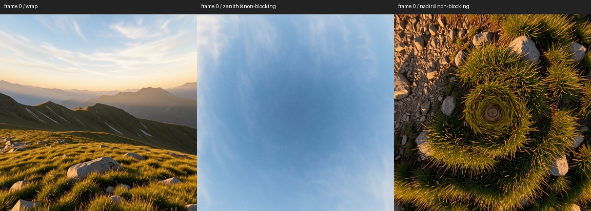
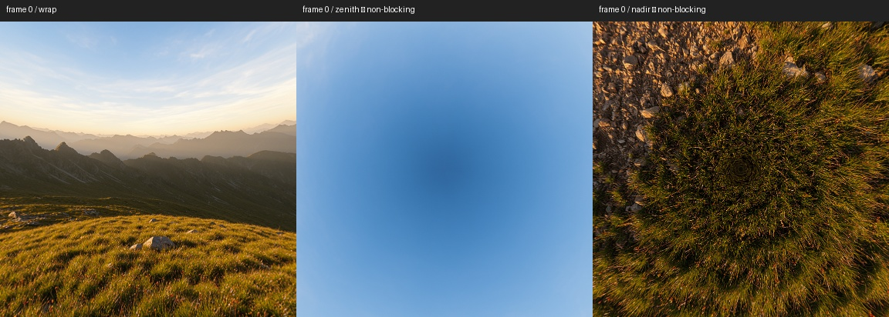

# ComfyUI longitude-wrap validation — October 20, 2026

The user revised acceptance: prioritize a seamless left/right spherical wrap
through ComfyUI. Record and minimize pole distortion, but do not let it block
a wrap pass. This supersedes the earlier full-sphere gate for this investigation;
the earlier measurements and failure decisions remain historical evidence.

## Acceptance

- Inspect the join in rectilinear views at pitch -45°, 0°, and +45°.
- Reject conspicuous vertical cuts, mismatched structures across the join,
  or a visible repair band. Low first/last-column error alone cannot pass.
- For videos, measure every lossless frame and inspect chronological wrap
  contact sheets plus pitched views at five times. This is a short-clip test,
  not a guarantee for longer clips or different camera motion.
- Record pole and subject defects separately. A **wrap pass** is not an
  artifact-free image or video claim.
- Confirm candidate settings on a second seed.
- Use existing installed models. Full FLUX.2-dev and its Mistral encoder are
  absent from the current model inventory; Klein results do not qualify them.

## Runtime and scope

Normal MCP-managed ComfyUI on `127.0.0.1:8188`, ComfyUI 0.39.0,
Python 3.12.10, PyTorch 2.12.0+cu130, RTX A6000 48 GB.
The code suite passed **118 tests, 4 skipped**. The skipped tests target the
absent development-only semantic-distortion node.

| Model | Encoding | Test settings | Status |
|---|---|---|---|
| Klein base 9B FP8 | Spherical width, scale 2 | 2048×1024, 50 Euler steps, CFG 4, geometry gamma 6, seeds 42/43 | Wrap pass on both seeds |
| Klein distilled 9B | Spherical width, scale 2 | 2048×1024, 4 Euler steps, CFG 1, seeds 42/43 | Wrap pass on both seeds |
| Klein base 9B FP8, smaller radius | Spherical width, scale 4 | Same base settings; halves coordinate radius, seeds 42/43 | Wrap pass on both; less distinct polar bullseye/spokes |
| LTX 2.3 distilled FP8 | Spherical width, blend 1, threshold 10, radius 1 | 1024×512, 65 frames, 8 Euler/simple steps, CFG 1, first-frame input, seeds 42/43 | Wrap pass on both seeds |
| LTX 2.5 distilled BF16 | Spherical width, blend 1, threshold 10, radius 1 | Same dimensions, frames and sampler; native 2.5 components, seeds 42/43 | Wrap pass on both seeds |
| MiniMax H3 FL2VA INT8 | Periodic longitude, blend 1 | 1024×512, 56 frames, 20 res_multistep/simple steps, first-frame input, seeds 42/43 | Wrap pass on both seeds |
| Full FLUX.2-dev | Not runtime-qualified | Required model and encoder absent | Not tested |

H3's patch is a periodic longitude adaptation, not the paper's spherical
latitude-dependent encoding. Do not describe all families as using identical
positional math. The LTX and FLUX model-scoped patch tests also check that
unrelated axes, text/audio positions and cached disabled branches are preserved.

The first-frame cases use the supplied `pano_2k_00013_.png`, a fixed-camera
prompt with the boy landing, no panorama LoRA, and rolling off. Decoder
comparisons share the exact same sampled latent:

- Klein: stock, circular pad 9 (native-equivalent context), and pad 18.
- LTX 2.3: stock, circular pad 4, and pad 8.
- LTX 2.5: stock, dual-rotation blend 4, and blend 1.
- H3: stock and dual-rotation blend 4.

## Evidence

`E:/ComfyUI-test-results/comfy-wrap-20261020/`

All **15 jobs completed and were visually reviewed**: four baseline stills,
six first-frame videos, three text-only video controls, and two radius
experiments. The nine selected video outputs contain **558 frames** in
total, all measured and inspected in wrap contact sheets.
The [compact evidence JSON](COMFY_WRAP_VALIDATION_2026-10-20.json) retains
job IDs, workflow hashes, implementation hashes, metrics and visual verdicts.

Local `cases.json` records job IDs and workflows. Each completed case retains server
history, lossless images, per-frame metrics, all-frame horizontal wrap sheets,
sampled pole views, and pitched wrap views. Explicit visual verdicts are saved
separately from execution success.

The fresh Klein base seed-42 circular-pad-9 output has boundary MAE 7.295/255,
ratio 0.969. Its terrain, horizon and clouds continue across the join in all
three inspected pitches. Nadir swirl and fine radial sky texture remain,
recorded as non-blocking. Compared with the earlier isolated-server output,
pixel MAE is 1.011/255; this normal-server run is not bit-identical and is
assessed independently.

Klein base seed 43 also passes (MAE 6.080, ratio 0.841), as do distilled
seeds 42 and 43 (MAE 8.409/11.040, ratios 0.848/1.097). Terrain, horizon and
clouds remain continuous in the inspected pitched wrap views. Distilled
outputs retain pronounced radial ground pinching and sky convergence.
These are explicitly **wrap-only passes** under the revised criterion.

A controlled base-model follow-up changes only spherical scale 2→4, halving
the coordinate radius. On both seeds it preserves the wrap while reducing
the distinct nadir bullseye and fine zenith spokes. Radial grass distortion
remains, and composition changes. Mean boundary MAE is 12.020/7.996 and
ratio 1.192/0.880 for seeds 42/43; these higher MAEs than scale 2 do not
correspond to a conspicuous visible cut. Recommend scale 4 as an optional
**Klein-base** profile for this scene. Do not extrapolate it to distilled
Klein, full FLUX.2-dev, or other scenes without checking. No global defaults
were changed.

Seed 43, scale 2 (wrap / zenith / nadir):

Same seed, scale 4:

The corresponding [seed-42 scale-2](media/wrap-validation-2026-10-20/klein_scale2_seed42.jpg)
and [scale-4](media/wrap-validation-2026-10-20/klein_scale4_seed42.jpg)
comparisons show the same reduction in distinct bullseye/spoke structure.

## First-frame video results

All six selected video outputs pass the revised wrap criterion. Every frame
was measured and inspected in chronological horizontal-join sheets; five
times per clip were also inspected at pitch -45°, 0° and +45°. Mountain
outlines, terrain and clouds continue through the join. Subjects can cross
it without a conspicuous split. The broad sky gradient and radial ground
stretching in the source persist. LTX changes the subject's identity/scale;
H3 also changes appearance and action. Those are recorded defects, not evidence
of correct motion.

| Model / seed | Selected decoder | Mean boundary MAE / 255 | Stock decoder MAE | Selected mean boundary ratio |
|---|---|---:|---:|---:|
| LTX 2.3 / 42 | Circular pad 4 | 6.948 | 13.245 | 1.312 |
| LTX 2.3 / 43 | Circular pad 4 | 7.493 | 16.234 | 1.426 |
| LTX 2.5 / 42 | Dual rotation, blend 1 | 4.790 | 15.326 | 1.203 |
| LTX 2.5 / 43 | Dual rotation, blend 1 | 5.323 | 15.045 | 1.415 |
| H3 / 42 | Dual rotation, blend 4 | 6.606 | 9.585 | 1.386 |
| H3 / 43 | Dual rotation, blend 4 | 6.533 | 9.185 | 1.358 |

These paired decoder comparisons isolate the decoder's boundary contribution:
the sampled latent is identical within each case. They do **not** isolate the
benefit of spherical encoding from the already seamless input. Separate
text-to-video controls remove the starting-image contribution.

The [executed API profiles](../example_workflows/wrap_validation_20261020/README.md)
retain their control branches and exact settings. This round does not qualify
outpainting, FLUX reference-image editing, gray-guide video, moving-camera
paths, long clips or full FLUX.2-dev.

## Text-only video controls

One seed-42 control per video family removes first-frame conditioning while
keeping the sampler, positional patch and decoder comparisons. All three
complete through ComfyUI and pass the longitude-only visual inspection of
every frame plus the five pitched samples. This establishes that continuous
wrap is possible without inheriting a seamless input. It is not a controlled
encoding-on/off comparison or a two-seed qualification of T2V quality.

| Model | Frames | Selected mean boundary MAE / 255 | Stock MAE | Mean ratio |
|---|---:|---:|---:|---:|
| LTX 2.3 | 65 | 3.624 | 24.431 | 0.986 |
| LTX 2.5 | 65 | 3.336 | 9.706 | 1.161 |
| H3 | 56 | 3.564 | 4.207 | 0.889 |

The text-only LTX outputs have severe polar convergence, soft/stylized detail
and distorted geometry; LTX 2.5 also has a strongly bowed horizon. H3 produces
a continuous join but pinched poles and camera drift despite the fixed-camera
prompt. These are **diagnostic controls, not recommended artist-quality
presets**. Prefer the first-frame profiles for the supplied panorama.
Their exact graphs are retained in the workflow folder's `controls/` directory.

## Implementation versus image quality

The unit suite checks model-local patch ownership, cached disabled branches,
video latitude indexing, untouched text/audio axes, FLUX reference-token
guards and H3 packed-layout behavior. The retained FLUX rolling fix also
handles scalar `patch_size` without treating it as a video tuple. Rolling is
off in the recommended profiles; that fix is not credited for these passes.

Periodic attention does not make the VAE periodic. The same-latent comparisons
show why the decoder must be included in a working profile. Conversely, fixing
the pixel boundary does not force the model to synthesize correct polar content.
The hybrid FLUX spherical table retains longitude-dependent high-frequency
channels at the poles; only its low-frequency spherical subspace converges.
Reducing the coordinate radius can change the distortion, but does not impose
full polar convergence.

## Final 121-frame LTX 2.5 acceptance run

The supplied `pano_2k_00013_.png` was used for job `119d216b-e38b-4970-a6a7-2fe9c8d1f7cc`: native LTX 2.5 distilled BF16, 1024×512, 121 frames at 24 fps, seed 42, eight Euler/simple steps, CFG 1, first-frame strength 1. Spherical RoPE uses blend 1 / threshold 10 / radius 1; native dual-rotation decode uses blend 1. No panorama LoRA, rolling or wrapped noise.

All 121 frames of the actual H.264 export were measured and inspected in chronological wrap sheets, with pitched wrap views and enlarged peak-score frames. Longitude wrap passed. Encoded mean boundary-jump ratio: 1.53862; maximum: 2.83775. Lossless mean: 1.412598; maximum: 2.76937. A boundary ratio is a diagnostic, not a standalone pass rule. Subject scale/appearance changes and duplication remain, as does pole stretching. This is not a motion-fidelity pass.

[Final MP4](media/wrap-validation-2026-10-20/pano13_ltx25_360.mp4) · [Sampled wrap/poles](media/wrap-validation-2026-10-20/ltx25_final_views.jpg) · [Exact API graph](../example_workflows/wrap_validation_20261020/ltx25_pano13_final_121f_API.json) · [Current canvas workflows](../example_workflows/README.md). Local full evidence: `E:/ComfyUI-test-results/pano13-final-ltx25-20261020/`.
