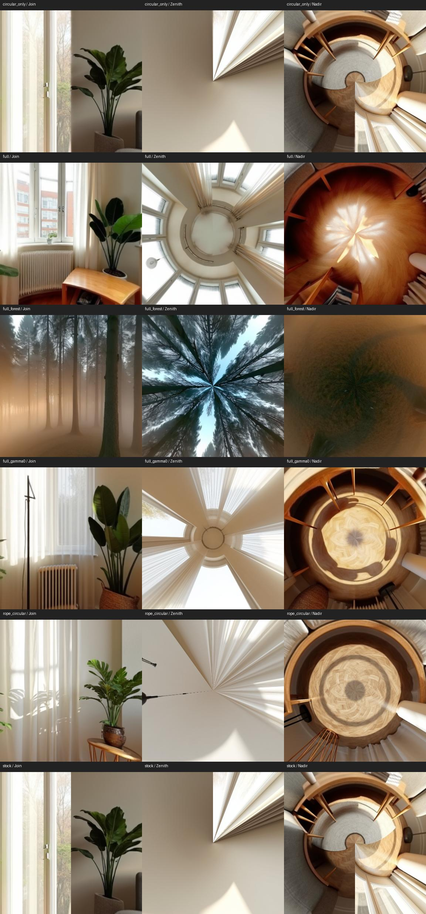
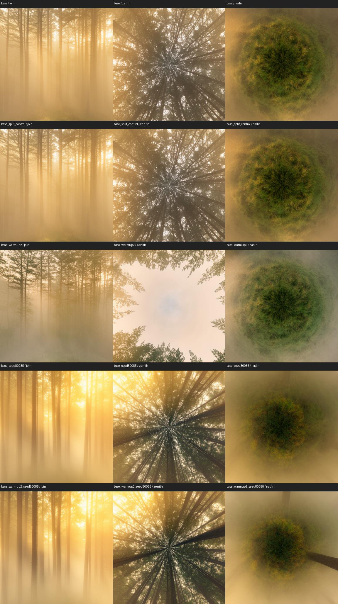
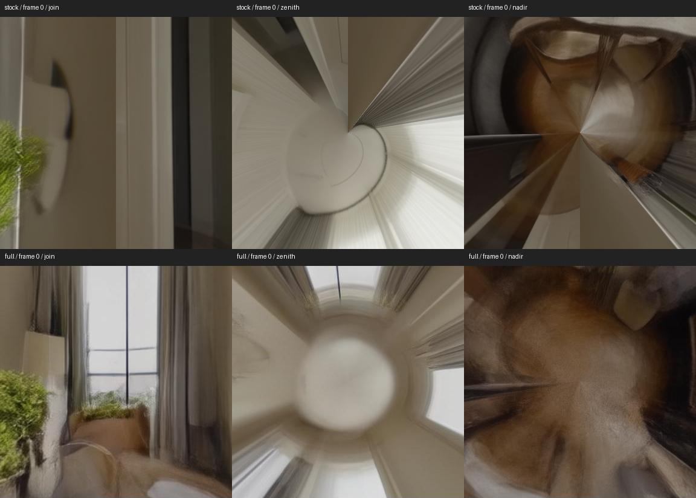
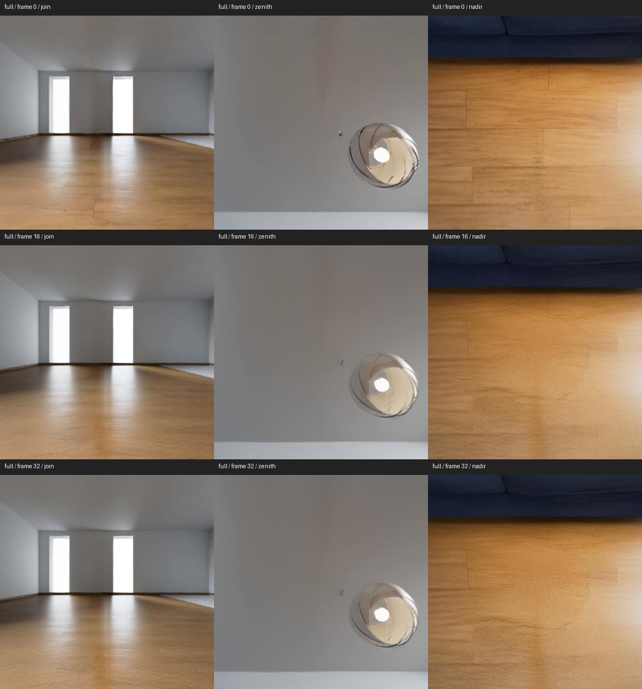
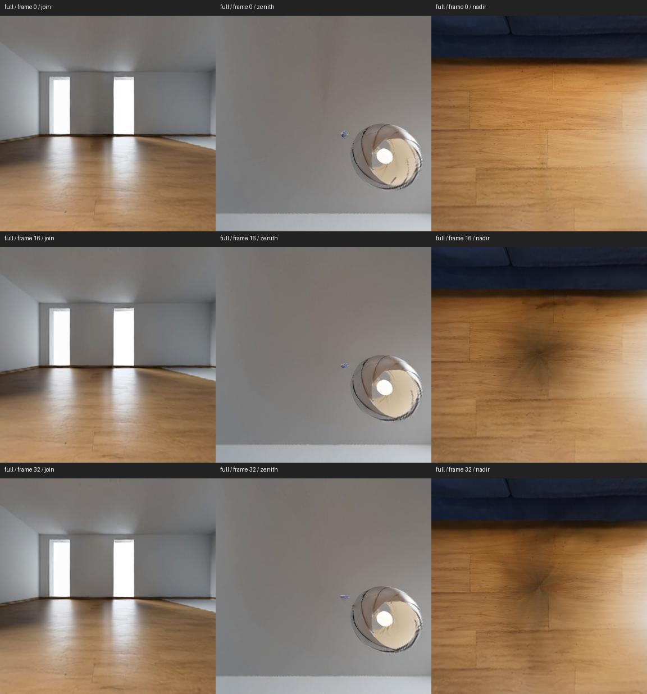
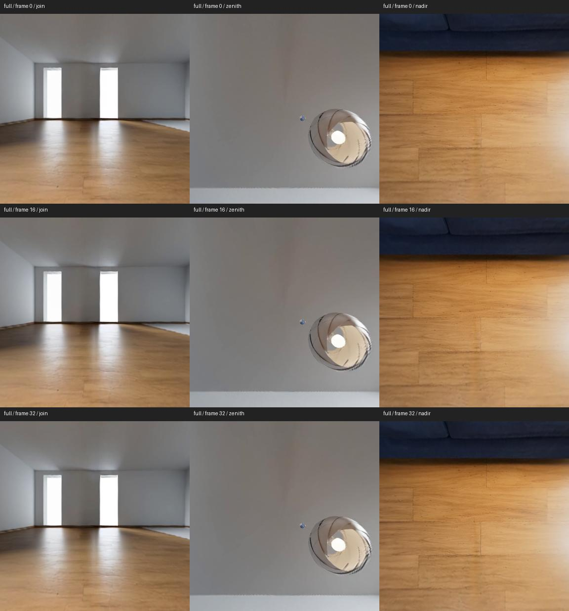

# Native SpheRoPE comparison — October 18, 2026

Standalone FLUX.1-dev images and native LTX 2.3 video now render through the original SpheRoPE implementation outside ComfyUI, using existing local weights. The full method reduces the tested left/right boundary jump, but the generated pole views still contain substantial distortion. This establishes that the remaining problem is not confined to ComfyUI. It does not transfer automatically to LTX 2.5, H3 or Klein.

## Standalone setup

- Original [orhir/SpheRoPE](https://github.com/orhir/SpheRoPE) commit `a40a86b49c25dbd4d0191591f28a0d5baf0c4ca4`; tracked source remained unchanged.
- Local checkout: `C:/Users/Cedar/Documents/SpheRoPE-native`.
- Existing FLUX.1-dev Diffusers directory: `E:/models/diffusers`. No model weights were downloaded for these image tests.
- Separate `.venv-flux` environment: Python 3.11.9, PyTorch 2.5.1+cu121, Diffusers 0.37.1, Transformers 4.56.2, Accelerate 1.10.1. TensorFlow/Flax disabled; offline model loading. ComfyUI dependencies were not changed.
- RTX A6000, model CPU offload, 1024x512, seed 80084, 28 steps, embedded guidance 3.5. The full method adds actual CFG 3.5 and geometry gamma 6 after the first two denoising steps. Native circular decoding uses 18 latent columns.

The initial full run used the original `generate_panorama.py` CLI and exited successfully. The other five runs called its unchanged `ERPFluxPipeline` Python API. Shared-model ablations restored the original positional embedder between runs through the upstream pipeline's own cleanup.

Living-room prompt:

> A modern sunlit living room with cream walls, warm oak floorboards, a gray fabric sofa, low wooden coffee table, tall windows with sheer curtains, a floor lamp and potted plants, realistic architectural photography.

The forest prompt matches the earlier Klein screening prompt. It is a second scene, not a second seed. These tests are text-to-image, not material transfer or image-to-video.

## Native results

| Living-room treatment | Boundary-jump ratio | Boundary MAE, 0–255 |
|---|---:|---:|
| Stock | 44.341 | 115.385 |
| Circular decode only | 13.019 | 34.069 |
| Spherical RoPE + circular decode | 1.665 | 4.808 |
| RoPE + circular + true CFG, geometry gamma 0 | 2.650 | 10.263 |
| Full native method, geometry gamma 6 | 0.556 | 2.249 |

The full native forest result has ratio 0.884 and boundary MAE 6.367. [Recorded metrics](validation/native-2026-10-18/native_metrics.json) include every image. The metric divides mean first/last-column absolute difference by the median of all adjacent-column differences, including the wrap column. Natural object edges can score highly; these numbers do not measure correct spherical geometry.



The full living-room result has much better boundary continuity, but floor lighting forms a star near the nadir and the ceiling/windows converge unnaturally around the zenith. The forest also retains a pinched canopy and radial ground texture. A smooth image boundary is not a guarantee of a coherent surrounding scene.

The gamma-zero control retains the full method's true CFG and delayed activation. Comparing it with gamma 6 isolates the geometry term more closely than comparing ordinary FLUX's embedded guidance against three-way CFG. These are single-seed observations, not a general parameter ranking.

## What matches and what differs in ComfyUI

The corrected LTX spherical width-angle builder matches the original native function exactly for grids 16x32, 32x64 and 64x128 at both 682 and 1024 frequency channels. The alternate ComfyUI-SpheRoPE FLUX.2 angle builder matches the native FLUX.2 cosine/sine table exactly on those grids. [Parity measurements](validation/native-2026-10-18/angle_parity.json) test the builders; they do not claim end-to-end sampler equivalence.

| Component | Native implementation | Current ComfyUI path |
|---|---|---|
| LTX positional encoding | Spherical width, stock time/height | Corrected spherical node matches tested angle math; EquiRoPE is a different method |
| Semantic guidance | Positive, negative and geometry predictions combined | Main pack's `EquiRoPEGeometricCFG` blurs a CFG delta; the alternate pack has the actual three-way guider |
| Native LTX sampling | Dev model at half resolution, then distilled-LoRA refinement | Selected native 2.5 presets use a single distilled stage at CFG 1 |
| FLUX guidance start | Skip the first two geometry/true-CFG steps in CLI defaults | Existing Klein base graph applies three-way guidance from the first step |
| FLUX circular decode | 18 latent columns | Klein graphs use 8 columns |
| Video motion assumptions | Geometry prompt locks the camera and scene | User's moving-camera and gray-video workflows require separate qualification |

Do not transplant FLUX.1's complete rotary embedding table onto FLUX.2/Klein: their positional axes and frequency bases differ. Likewise, the native LTX guidance prompt explicitly suppresses camera motion, so copying it into a moving-camera workflow would conflict with the intended result.

## Applying the findings in ComfyUI

Six additional MCP jobs completed with the existing Klein models. Each padding test decodes the same sampled latent at 0, 8 and 18 columns; only the decoder changes. These are image tests, not video results. [API graphs](../example_workflows/native_reference_20261018/README.md), [job IDs](validation/native-2026-10-18/comfy_jobs.json) and [measurements](validation/native-2026-10-18/comfy_metrics.json) are included.

| Model / seed / guidance | No circular pad | Pad 8 | Pad 18 |
|---|---:|---:|---:|
| Klein distilled / 80084 | 2.355 | 0.838 | 0.836 |
| Klein base / 80084 / three-way from start | 2.797 | 0.896 | 0.898 |
| Klein base / 80085 / three-way from start | 2.131 | 1.036 | 1.034 |
| Klein base / 80084 / two-step warmup | 3.066 | 0.936 | 0.936 |
| Klein base / 80085 / two-step warmup | 2.315 | 1.177 | 1.176 |

Wider padding produced very similar results on these samples and did not fix the poles. Keep the existing eight-column Klein baseline; the native FLUX.1 receptive-field setting is not evidence that every model needs 18 columns.

The warmup graph uses `SplitSigmas(step=2)`, positive-only `BasicGuider` for two steps, then `DisableNoise` and the existing three-way guider for the remaining 18 steps. The second sampler receives output 0 from the first sampler so it continues from the noisy intermediate latent. This transfers the native CLI's delayed guidance idea without adding or monkeypatching runtime nodes.

At seed 80084, the warmup opens the canopy at the zenith and reduces its pinching, while the nadir remains distorted. Seed 80085 still has a tightly converging canopy. Edge ratios increase slightly in both warmup samples. The improvement is not consistent enough to replace the baseline.

The split-sampler control uses the same three-way guider in both stages. It differs from the unsplit result by mean 0.480/255 and maximum 63, so splitting is not pixel-exact. The warmup differs from this split control by mean 40.823/255, and their pole views differ substantially. This supports a guidance effect for that seed, but not exact Diffusers/ComfyUI sampler equivalence. Only seed 80084 has the additional split control.



The tested LTX 2.5 artist defaults remain unchanged. No further rotary formula correction is justified by the parity measurements. The three-way method should be evaluated as its own guided sampling stage on an appropriate backbone, rather than treating a CFG-delta blur at CFG 1 as equivalent. Moving-camera video and the user's gray-guide path still need native video comparison.

## Native LTX video status

The existing local files are sufficient to load native LTX 2.3. The earlier assessment that additional model downloads were needed was incorrect: `gemma_3_12B_it.safetensors` contains the SentencePiece tokenizer, vision tower and projector as well as the language model. A standalone adapter maps its keys and verifies all 1,066 parameter shapes against the native model. Token IDs match the extracted SentencePiece model for the positive, negative and geometry prompts. No model weights were downloaded.

The official LTX source is pinned at `780984275fd47128b02bef9b5c085404276866ee`, the latest commit before this SpheRoPE release. The standalone LTX imports succeed using Python 3.11, PyTorch 2.8.0+cu128 and Transformers 4.56.2, plus local OpenImageIO/SentencePiece dependencies. Both source checkouts remain unmodified. The [standalone runner](../scripts/compare_native_ltx.py) applies these explicit runtime adaptations:

- Remap local Gemma keys and extract its embedded tokenizer; no ComfyUI inference modules are imported.
- Accept only the default `streaming_prefetch_count=None`, which this native revision does not accept as a keyword. Non-default requests fail explicitly. [Original API failures](validation/native-2026-10-18/ltx_native_api_probe.json) remain recorded.
- Unwrap `DenoisedLatentResult.denoised` for SpheRoPE's custom stage-one control loop. Without this adaptation, the stock/geometry-disabled control fails because the newer native guider returns a result object instead of a tensor. Stage two continues to use the native result-aware Euler loop.
- Use native `fp8_cast.build_policy` to consume the installed checkpoint's quantization scales. This entails native FP8 recasting and is not an exact BF16 reference comparison.
- Use `--disable-triton-fusion` to select LTX's existing deterministic PyTorch LoRA merge. The installed Windows Triton compiler failed on its temporary-file path during stage-two LoRA fusion. This rounding path differs from the Triton stochastic merge.

The first attempt completed all 30 low-resolution sampling steps before that compiler failure. The fallback run completed both sampling stages and decoded 17 frames at 1024x512. Its BF16 output needed conversion to float/uint8 for PNG export; the saved decoded tensors were recovered without resampling. The mean boundary ratio is 0.805, maximum 0.969, but rectilinear zenith/nadir views show severe radial smearing. Boundary continuity alone is not sufficient evidence of correct spherical geometry.

The stock control also completed. Both use seed 80084, 30 Euler steps at 512x256, native x2 latent upscaling, then three Euler refinement steps at 1024x512 with the existing distilled LoRA at 0.8. There is no panorama LoRA. Wrapped noise and prompt enhancement are off. The control disables spherical RoPE, geometry guidance and circular upscaling/decoding together. CFG is video 3/audio 7; extra STG/rescale/modality guidance is disabled because the original three-way branch does not apply those terms. This is a combined-method comparison, not an isolation of each feature.

| Native LTX 2.3 text-to-video | Frames | Mean boundary ratio | Maximum ratio | Mean edge jump /255 |
|---|---:|---:|---:|---:|
| Stock control | 17 | 12.421 | 12.779 | 23.560 |
| SpheRoPE, geometry gamma 3 | 17 | 0.805 | 0.969 | 2.956 |

The raw boundary jump decreased about 87%. Neither clip has convincing poles: the stock clip has sharp radial convergence and the full method smears that convergence into broad circular regions. These short, low-resolution FP8 runs establish runtime behavior, not 4K quality or equivalence to the paper's BF16 results. A [three-tensor probe](validation/native-2026-10-18/ltx_fp8_recast_probe.json) measures 2.5–3.4% relative RMS change from native FP8 recasting, so precision is another qualification limit.



[Stock preview](media/native-2026-10-18/ltx23_native_stock.mp4), [SpheRoPE preview](media/native-2026-10-18/ltx23_native_full.mp4), [stock per-frame metrics](validation/native-2026-10-18/ltx_stock_metrics.json), [full-method per-frame metrics](validation/native-2026-10-18/ltx_full_metrics.json). Preview MP4s are silent; measurements use lossless PNGs, and native decoded tensors/audio remain in the local experiment folder.

### Native first-frame result

The same two-stage native pipeline also completed 33 frames at 1024x512 from
`Living_Room_01_Couch_color_firstframe.png`, with first-frame strength 1 in both
stages, no panorama LoRA, and a fixed-camera preservation prompt. Temporal VAE
tiling uses 32-frame tiles with 16-frame overlap; spatial tiling is disabled.
The mean boundary ratio is **0.716**, maximum **0.897**, and mean edge jump
**1.507/255**. The input reference resized for inspection measures 0.834 and
1.208/255; these ratios are not a fidelity score.

The join, ceiling and floor remain substantially more coherent than the native
text-to-video result. Floor grain swirls/softens and small ceiling details drift,
so this is a promising stationary-camera screen, not a claim of rigid geometry
or a fully solved video pipeline. The clip lasts 1.375 seconds at 24 fps.



[First-frame preview](media/native-2026-10-18/ltx23_native_firstframe.mp4),
[run settings](validation/native-2026-10-18/ltx_i2v_result.json),
[per-frame measurements](validation/native-2026-10-18/ltx_i2v_metrics.json).

### ComfyUI finding and fix

Two MCP submissions reached the circular upscaler and failed with
`'ModelPatcherDynamic' object has no attribute 'parameters'`:
`0489659b-2fe4-4879-b891-2141a8607628` (text-to-video) and
`ed4b0cb8-8ce5-40e4-b896-2b42bbbdef5b` (first-frame).
[Failure traces](validation/native-2026-10-18/ltx_comfy_upscaler_failures.json)
identify the companion pack's `SpheRoPECircularUpscale`, not the native runner.

The node assumed the loader returned a raw `nn.Module`. Current ComfyUI returns
a model patcher whose load/offload lifecycle belongs to core. The local
`ComfyUI-SpheRoPE/spherope/nodes/node_circular.py` fix delegates the padded
upscale to `LTXVLatentUpsampler.execute`, crops the result and retains the
original first-frame mask. It removes duplicated device/normalization logic.
The regression reproduced the failure before the fix; the companion suite now
passes **124 tests**. Its obsolete rotary test oracle was also updated to call
ComfyUI's actual stock method and check the current rotation-matrix output.
The pre-existing edit to `spherope/core/rope_patch.py` was preserved.

A separate CPU runtime check loads the **real local upscaler** through ComfyUI's
loader and the **real checkpoint's VAE normalization statistics**. The fixed
node matches a manually padded/core-upscaled/cropped reference exactly
(maximum error 0), returns finite values and preserves the first-frame mask.
[Runtime evidence](validation/native-2026-10-18/ltx_upscaler_runtime.json).
After the server restart, **both complete workflows succeeded through MCP**:

| ComfyUI run | Frames | Mean boundary ratio | Maximum ratio | Mean edge jump /255 |
|---|---:|---:|---:|---:|
| Two-stage text-to-video | 17 | 0.684 | 0.704 | 2.797 |
| Two-stage ERP first-frame | 33 | 0.528 | 0.691 | 0.731 |

Both output 1024x512 lossless PNG frames. Runtime was about 90 and 96 seconds,
respectively. A ratio below 1 means the boundary jump is smaller than the median
interior adjacent-column jump; it does not establish correct spherical geometry.
The join views at the first, middle and final frames look continuous. The
text-to-video nadir still swirls severely. First-frame conditioning preserves
the room and ceiling, but a dark pinched patch develops at the nadir. This is
more conspicuous than the native first-frame result, despite its lower seam metric.

[Text-to-video preview](media/native-2026-10-18/ltx23_comfy_t2v.mp4),
[first-frame preview](media/native-2026-10-18/ltx23_comfy_i2v.mp4),
[text-to-video execution](validation/native-2026-10-18/ltx_comfy_t2v_run.json),
[first-frame execution](validation/native-2026-10-18/ltx_comfy_i2v_run.json),
[text-to-video measurements](validation/native-2026-10-18/ltx_comfy_t2v_metrics.json),
[first-frame measurements](validation/native-2026-10-18/ltx_comfy_i2v_metrics.json).



### First-frame pole isolation controls

Two further 33-frame MCP runs changed one setting from the spherical first-frame
graph, keeping the same image, seed, prompts, schedule and circular operations:

| Variant | Mean boundary ratio | Mean edge jump /255 | Sampled nadir result |
|---|---:|---:|---|
| Spherical RoPE, gamma 3 | 0.528 | 0.731 | Dark pinched patch develops |
| Spherical RoPE, gamma 0 | 0.524 | 0.740 | Patch persists; disabling guidance is insufficient |
| Stock RoPE, gamma 3 | 0.506 | 0.685 | Pronounced pinch absent; floorboards remain more coherent |

The stock-RoPE control disables both spherical patch nodes and retains circular
upscaling/decoding. Its first/middle/final join views remain continuous. This
isolates a contribution from spherical RoPE in this workflow; it does not prove
a formula error, nor that stock RoPE can generate seamless panoramas without a
correct first frame. Text-to-video benefits and first-frame preservation must be
judged separately. The stock-RoPE result is the better starting point for this
specific stationary first-frame case, with minor texture and lighting drift.
It is one seed, one image and 1.375 seconds, not moving-camera qualification.



[Better first-frame graph](../example_workflows/native_reference_20261018/ltx23_firstframe_stockrope.json),
[video preview](media/native-2026-10-18/ltx23_comfy_i2v_stockrope.mp4),
[execution evidence](validation/native-2026-10-18/ltx_comfy_i2v_stockrope_run.json),
[measurements](validation/native-2026-10-18/ltx_comfy_i2v_stockrope_metrics.json).
The [gamma-zero control](../example_workflows/native_reference_20261018/ltx23_firstframe_gamma0.json)
also completed; its [execution](validation/native-2026-10-18/ltx_comfy_i2v_gamma0_run.json)
and [measurements](validation/native-2026-10-18/ltx_comfy_i2v_gamma0_metrics.json)
retain the negative result.

The delivered [two-stage graph](../example_workflows/native_reference_20261018/ltx23_two_stage.json)
and [first-frame graph](../example_workflows/native_reference_20261018/ltx23_firstframe.json)
transfer the dev-to-distilled schedule, disable wrapped noise, use Euler,
retain geometry gamma 3 only in the dev stage, and apply four-column circular
upscaling/decoding. They use the main pack's model-scoped spherical RoPE and
the companion pack's guider/circular nodes. ComfyUI runs video-only here;
native LTX also sampled audio, and framework noise/precision paths differ.
These are structural comparisons, not claims of pixel parity.

The [original repo](https://github.com/orhir/SpheRoPE) provides LTX 2.3, FLUX.1-dev and FLUX.2-dev pipelines. It does not provide native LTX 2.5, H3 or Klein pipelines. Full FLUX.2-dev was not installed or tested in this comparison.

The native first-frame test does not qualify gray-guide/Ripple video, moving
cameras, longer durations, or 4K. The LTX 2.5 artist presets are unchanged.

### Reproduce native LTX locally

Use the standalone Python environment described above, not ComfyUI's embedded
Python. `validation_deps` supplies the existing local OpenImageIO and
SentencePiece dependencies; the runner adds the two source repositories to
its import path and forces offline model loading.

```powershell
$env:PYTHONPATH = 'C:/Users/Cedar/Documents/SpheRoPE-native/validation_deps'
python scripts/compare_native_ltx.py --reference-repo C:/Users/Cedar/Documents/SpheRoPE-native --ltx-repo C:/Users/Cedar/Documents/LTX-native-reference --models E:/models --output-dir output/native-ltx-repeat --case full --disable-triton-fusion
python scripts/inspect_native_video.py output/native-ltx-repeat --prefix full
```

Use `--case stock` for the control. For image-to-video, add `--frames 33`,
`--image <absolute-path-to-your-ERP-frame>` and a preservation prompt.
The installed checkpoint, Gemma, distilled LoRA and x2 upscaler are read in
place. The runner does not download or rewrite model weights.

## Reproduce the image comparison

Use the original checkout and a standalone environment satisfying its requirements. The local Diffusers directory must already contain FLUX.1-dev, its encoders, tokenizers, scheduler and VAE. The runner refuses a missing local model and disables Hub downloads.

```powershell
python scripts/compare_native_spherope.py --reference-repo C:/Users/Cedar/Documents/SpheRoPE-native --model-dir E:/models/diffusers --output-dir output/native-flux1-reproduction --prompt "A modern sunlit living room with cream walls, warm oak floorboards, a gray fabric sofa, low wooden coffee table, tall windows with sheer curtains, a floor lamp and potted plants, realistic architectural photography."
```

Run this with the standalone environment's Python, after freeing GPU memory used by other pipelines. The five cases change only the listed inference features; they use the same prompt, seed, resolution and steps. The delivered runner's stock case was also executed: its PNG matches the earlier stock result exactly, with maximum pixel difference zero ([reproduction check](validation/native-2026-10-18/runner_reproduction.json)). This seventh standalone run checks the runner, not an additional independent sample. Raw native PNGs/logs remain in the standalone checkout's `validation_20261018` directory. No cloud generation or media upload was used.
